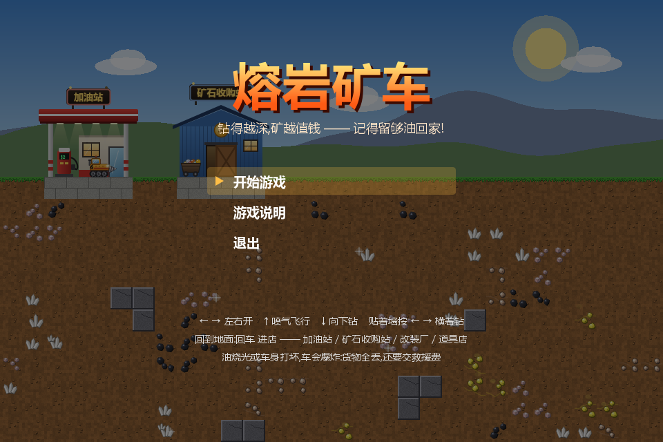
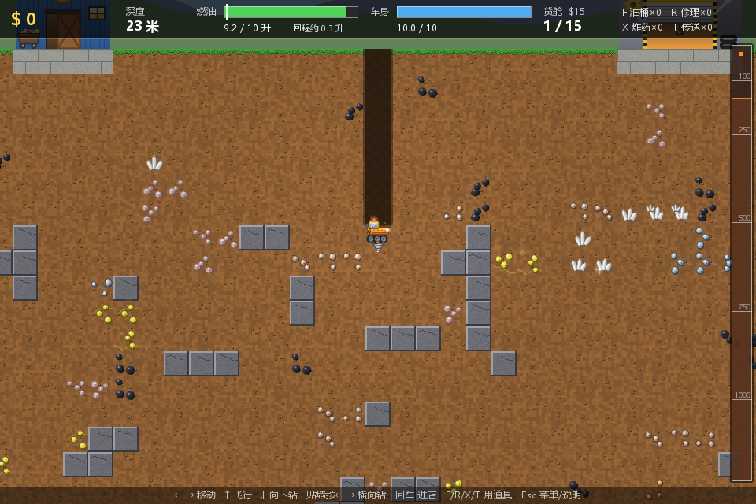
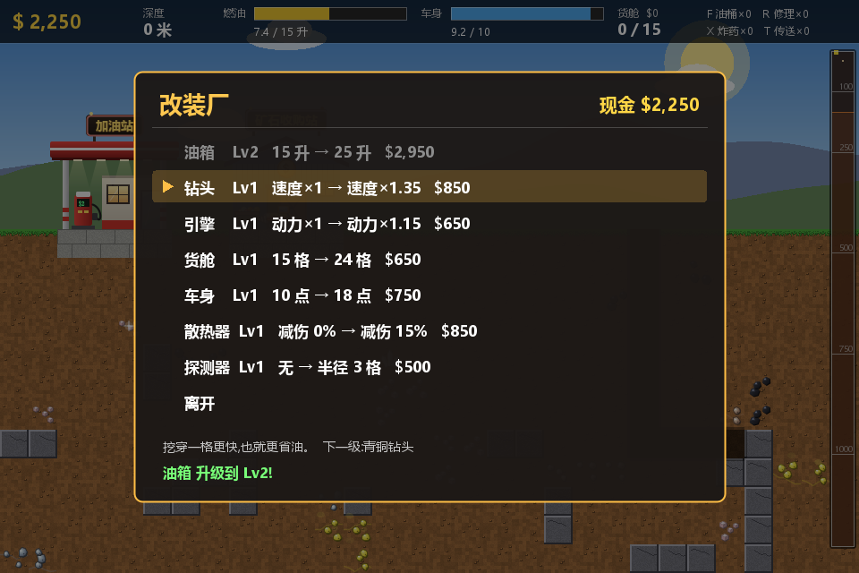
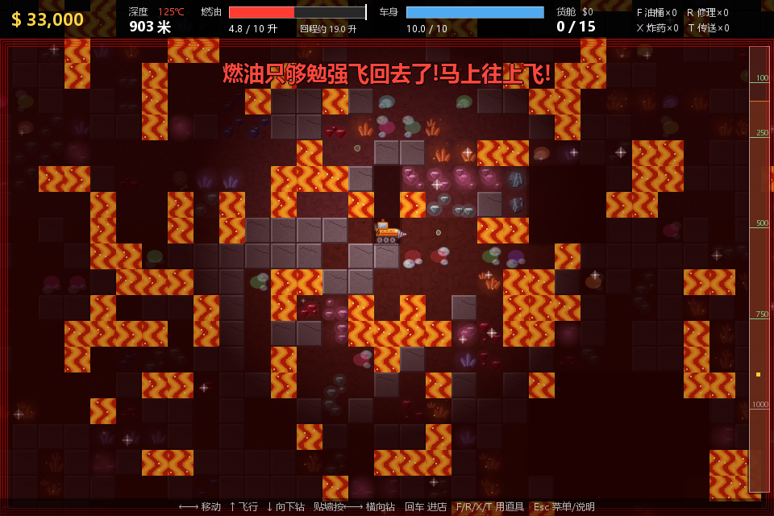
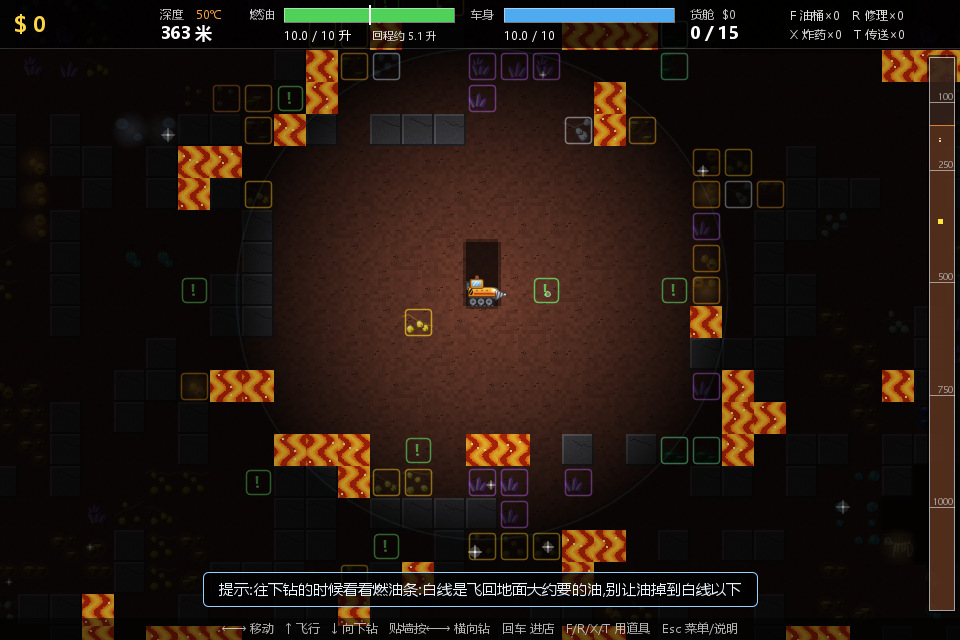

# 熔岩矿车 LavaDigger

> 钻得越深,矿越值钱 —— 记得留够油回家!

一个纯 Java Swing 写的横版挖矿游戏,致敬高中时在塞班手机上玩的「熔岩矿车」(原型是 PC 上的 *Motherload*)。

开着矿车往地下钻,挖矿、回地面卖钱、升级车子,再往更深的地方钻。越往下矿越值钱,但油耗越大、危险越多。地底最深处藏着 6 颗「熔岩之心」,全部挖出来卖掉就通关。



## 特点

- **零依赖**:只用 JDK 自带的 Swing,没有任何第三方库
- **没有一张图片资源**:所有贴图、矿车、商店、窗口图标都是启动时用代码画出来的;音效也是代码合成的 PCM
- **一个 jar 就能玩**:约 90 KB,Java 8 及以上都能跑
- **内容**:27 种矿石 + 熔岩之心 + 4 种地下宝藏,7 种可升级部件(每种 7 档),4 种道具,一千多米深的随机地图
- **会自动存档**:离开商店、暂停、关窗口时自动存,下次打开选「继续游戏」

| 往下钻 | 改装厂 |
|---|---|
|  |  |

| 900 米深处(地热 + 燃油报警) | 探测器 |
|---|---|
|  |  |

## 怎么启动

### 1. 装好 Java

需要 **Java 8 或更高版本**。命令行输入下面这条,能看到版本号就说明装好了:

```bash
java -version
```

没装的话去 [Adoptium](https://adoptium.net/) 下载一个 JDK 或 JRE 装上。

### 2. 下载游戏

从 [Releases](../../releases) 下载 `LavaDigger.jar`(仓库根目录里也有同一个文件)。

### 3. 运行

```bash
java -jar LavaDigger.jar
```

Windows 上如果 `.jar` 已经关联了 Java,直接双击也能打开。

存档会写在 jar 所在文件夹的 `save/lava.properties`,换电脑时把这个文件一起拷走就行。

## 操作

| 按键 | 作用 |
|---|---|
| ← → (或 A D) | 左右行驶 |
| ↑ (或 W) | 喷气往上飞(很费油);往下掉时按住可以刹车,减轻摔伤 |
| ↓ (或 S) | 向下钻 |
| 贴着墙按 ← / → | 横着钻(不能往上钻) |
| 回车 (或 E) | 停在商店门口时进店 |
| F / R / X / T | 道具:备用油桶 / 修理包 / 炸药 / 紧急传送 |
| Esc | 暂停 / 存档 / 看说明 |
| M | 静音 |
| F11 | 全屏 |

## 怎么玩

1. 在地面「加油站」加满油,从空地往下钻
2. 挖到的矿自动装进货舱
3. 盯着燃油条 —— 上面的白线是飞回地面大约要的油,油掉到白线附近就该往回飞了
4. 回到地面去「矿石收购站」卖矿
5. 去「改装厂」升级油箱、钻头、引擎、货舱、车身、散热器、探测器,去「道具店」买救命道具
6. 继续往更深处挖

**危险**:熔岩(烧血)、伪装成泥土的瓦斯(一挖就炸)、摔落、150 米以下的地热(越深越费油)、300 米以下的地震落石。
**燃油耗尽或车身归零车就会爆炸**:货物全丢、扣 25% 现金当救援费,新车送回地面。

游戏里按 Esc → 游戏说明,有完整的矿石价目表和各种规则。

## 从源码构建

**Windows**:双击或运行 `build.bat`,会在根目录生成 `LavaDigger.jar`。

**macOS / Linux**:

```bash
mkdir -p build/classes
javac -encoding UTF-8 --release 8 -nowarn -d build/classes src/lavadigger/*.java
echo "Main-Class: lavadigger.Main" > build/manifest.txt
jar cfm LavaDigger.jar build/manifest.txt -C build/classes .
java -jar LavaDigger.jar
```

需要 JDK 9 或更高版本来编译(`--release 8` 是 JDK 9 才有的参数),编出来的 jar 在 Java 8 上也能跑。

## 代码结构

```
src/lavadigger/
├── Main.java         入口,窗口、全屏、失焦暂停
├── GamePanel.java    核心:状态机、物理、钻探、商店菜单、特效、渲染、键盘输入
├── World.java        地图网格与随机生成
├── Mineral.java      矿石定义(价格、深度分布、贴图样式)
├── Upgrades.java     部件升级和道具的数值表
├── Player.java       玩家状态
├── Shop.java         地面上的四家商店
├── Art.java          矿车和商店的矢量绘制
├── Textures.java     启动时用代码生成全部贴图
├── Sfx.java          代码合成音效
└── SaveManager.java  存档读写与老存档升级
tools/lavadigger/     离屏自测和经济模拟(不打进 jar)
```
